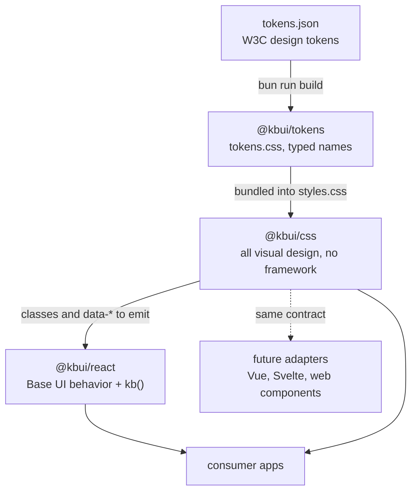
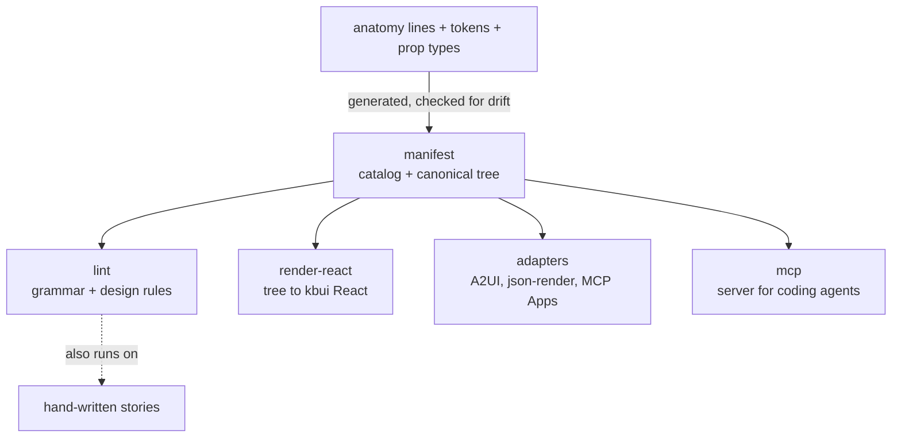

# Architecture

kbui has three packages. `@kbui/tokens` holds the values, `@kbui/css` turns them into styles, and `@kbui/react` adds behavior. Each package builds on the one below it. The React package meets the CSS only through the class and attribute names it renders, and a one-line comment at the top of each component stylesheet, the anatomy contract, keeps the two in agreement.



## Package responsibilities

| Package | Owns | Does not own |
|---|---|---|
| `@kbui/tokens` | Every value: colors, spacing, radii, type sizes and component sizes, in light and dark | Anything about components |
| `@kbui/css` | Every visual rule, keyed on `kb-` classes and `data-*` attributes | JavaScript; it works with any renderer |
| `@kbui/react` | Behavior: focus, keyboard support and ARIA from Base UI, and the `kb()` helper that maps props to classes and attributes | CSS; it imports none |

Because the styling does not depend on React, supporting another framework means writing an adapter that renders the same markup. Tokens and CSS stay unchanged.

## The anatomy contract

Every file in `packages/css/src/components/` opens with a comment describing the component's markup. From `button.css`:

```css
/* Anatomy: .kb-button [data-variant=primary|secondary|ghost|danger] [data-size=sm|md|lg] [data-disabled] */
```

The rules:

- Each component has one root class, `kb-<name>`. Its parts are `kb-<name>-<part>`.
- Variants and sizes are `data-*` attributes with string values.
- On/off states such as `data-disabled`, `data-open` and `data-invalid` are attributes without a value, which matches how Base UI writes them.
- Selectors never reach into another component, so specificity stays flat and overrides stay predictable.

On the React side, `kb(name, attrs, className)` produces the matching props. It returns `{ className: "kb-<name> …", "data-<key>": value }` and omits any attribute whose value is `false` or `undefined`.

## Enforcement

The contract is checked by tests, not by review alone. `bun run check` fails when:

| Problem | Caught by |
|---|---|
| A token aliases one that does not exist, two tokens produce the same name, or a key contains invalid characters | `packages/tokens/src/build.test.ts` |
| A stylesheet lacks its `Anatomy:` line, or never styles the root class it names | `packages/css/src/build.test.ts` |
| Component or reset CSS uses a palette color such as `--kb-gray-500`, or a raw color such as `#fff` | `packages/css/src/build.test.ts` |
| A component folder lacks its story or its test | `packages/react/src/story-coverage.test.ts` |
| `panel.css` clips anything, filters anything but `.kb-panel-glow`, or blurs the backdrop of anything but `.kb-panel-plate` | `packages/css/src/build.test.ts` |
| The Storybook skin fixture sets a property outside `--kb-panel-*` and `--kb-status-*`, or uses a `.kb-*` selector or `!important` | `apps/storybook/stories/skin-fixture.test.ts` |

In addition, `bun run test:stories` renders every story in a real browser and fails on any accessibility violation.

## Build output

| Package | Built with | Output in `dist/` |
|---|---|---|
| tokens | `bun scripts/build.ts` | `tokens.css`, `tokens.js`, `tokens.d.ts` |
| css | `bun scripts/build.ts`, using lightningcss | `styles.css` (tokens, reset and every component, minified), `reset.css`, `components/*.css` |
| react | `vite build`, then `tsc -p tsconfig.build.json` | `index.js` and type declarations |

The root `bun run build` runs them in that order. The CSS must build after the tokens because it bundles their output. Nothing else depends on the order.

## Planned: generative UI layers

None of this exists yet. The [product document](product.md) and the [roadmap](roadmap.md) add layers above the existing packages so that agents can compose kbui screens:



Two rules keep these layers in order:

- The manifest is generated from the anatomy contract and is never written by hand ([0005](decisions/0005-catalog-and-quality-layer-not-runtime.md)). A test fails if a component and its catalog entry disagree.
- Every layer works on kbui's own tree format ([0006](decisions/0006-canonical-tree-adapters-at-edge.md)). Outside formats appear only in adapters, so an upstream change touches one adapter.

## Background

The [decision records](decisions/README.md) explain the larger choices, including why kbui has no package registry and releases tarballs on GitHub instead.
