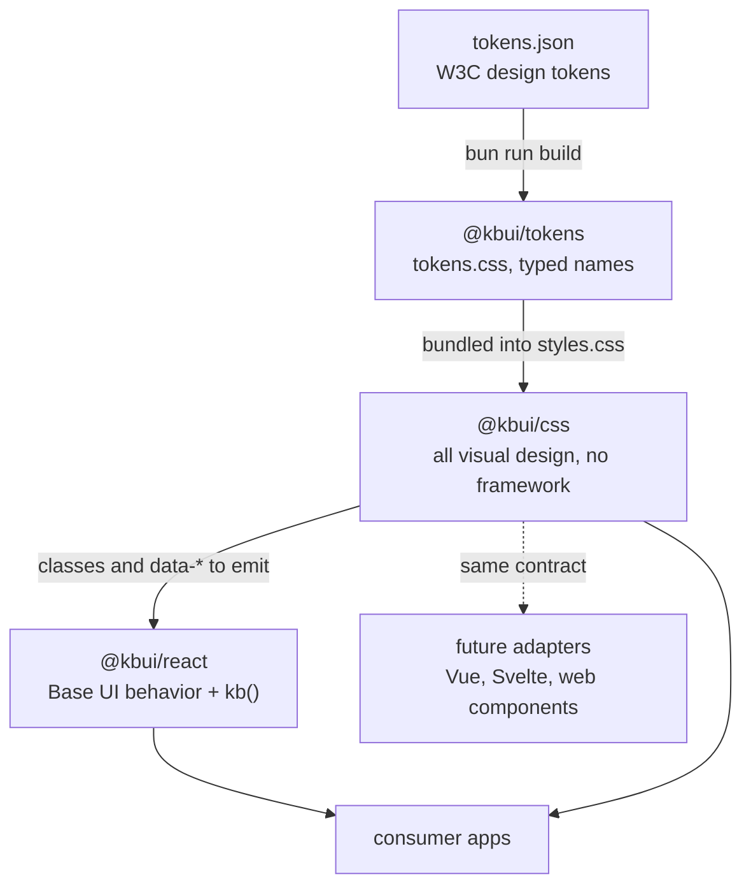

# Architecture

kbui has three packages. Tokens hold the values, the CSS turns those values into styles, and the React package adds behavior on top. Each package builds on the one below it, and React only meets the CSS through the class and attribute names it renders. A one-line comment at the top of every component stylesheet, which we call the anatomy contract, keeps the two in agreement.



## What each package owns

`@kbui/tokens` owns every value: colors, spacing, radii, type sizes and the few sizes specific to components, in both light and dark. It knows nothing about components.

`@kbui/css` owns every visual rule. Styles hang off `kb-` classes and `data-*` attributes. There's no JavaScript in it, so it doesn't care which framework renders the markup.

`@kbui/react` owns behavior. Focus handling, keyboard support and ARIA come from Base UI, and the `kb()` helper turns props into the right classes and attributes. It doesn't import any CSS.

Because none of the styling depends on React, supporting another framework later means writing a new adapter that renders the same markup. The tokens and CSS wouldn't change.

## The anatomy contract

Every file in `packages/css/src/components/` opens with a comment describing the component's markup. Here's the one from `button.css`:

```css
/* Anatomy: .kb-button [data-variant=primary|secondary|ghost|danger] [data-size=sm|md|lg] [data-disabled] */
```

Each component has one root class, `kb-<name>`, and its parts are named `kb-<name>-<part>`. Variants and sizes are `data-*` attributes with string values. On/off states like `data-disabled`, `data-open` and `data-invalid` are attributes without a value, which is also how Base UI writes them. Selectors never reach into another component, so specificity stays flat and overrides stay predictable.

On the React side, `kb(name, attrs, className)` produces the matching props. It returns `{ className: "kb-<name> …", "data-<key>": value }` and leaves out anything that's `false` or `undefined`.

## What keeps it honest

We don't rely on people remembering the contract. `bun run check` fails if:

| Problem | Caught by |
|---|---|
| A token points at one that doesn't exist, two tokens end up with the same name, or a key has odd characters | `packages/tokens/src/build.test.ts` |
| A stylesheet is missing its `Anatomy:` line, or never actually styles the root class it names | `packages/css/src/build.test.ts` |
| Component or reset CSS uses a palette color like `--kb-gray-500`, or a raw color like `#fff` | `packages/css/src/build.test.ts` |
| A component folder is missing its story or its test | `packages/react/src/story-coverage.test.ts` |

On top of that, `bun run test:stories` renders every story in a real browser and fails if the accessibility scan finds anything.

## What the build produces

| Package | Built with | Output in `dist/` |
|---|---|---|
| tokens | `bun scripts/build.ts` | `tokens.css`, `tokens.js`, `tokens.d.ts` |
| css | `bun scripts/build.ts`, using lightningcss | `styles.css` (tokens, reset and every component, minified), `reset.css`, `components/*.css` |
| react | `vite build`, then `tsc -p tsconfig.build.json` | `index.js` and type declarations |

The root `bun run build` runs them in that order. The CSS has to build after the tokens because it bundles their output; nothing else depends on the order.

## Why it's built like this

The [decision records](decisions/README.md) explain the bigger choices, including why there's no package registry.
