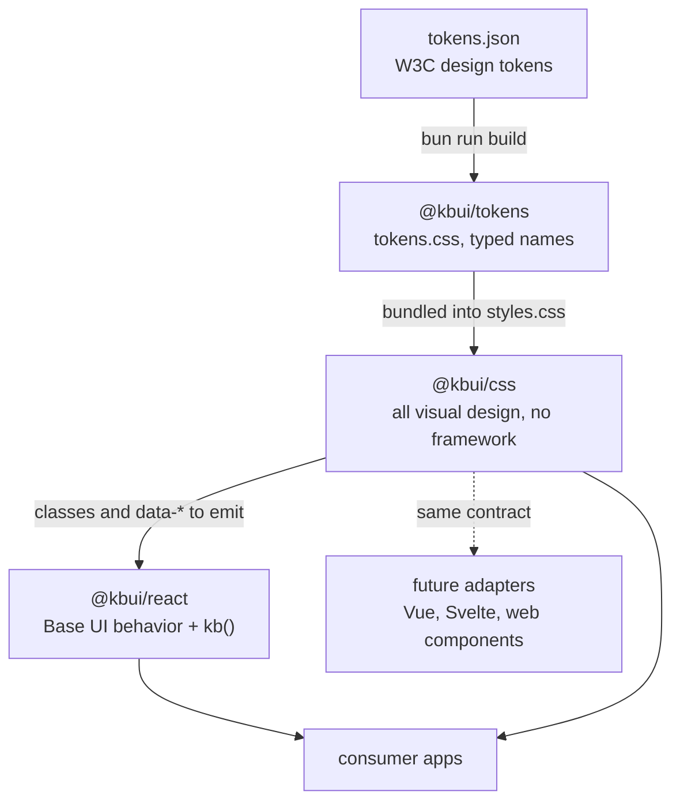

# Architecture

kbui is three packages in a line, joined by one contract: each component's stylesheet declares its classes and `data-*` attributes on its first line, and any framework layer only renders that markup.



## Layers

| Layer | Owns | Does not own |
|---|---|---|
| `@kbui/tokens` | Every value: color, space, radius, type, component sizes; light and dark | Any selector or component |
| `@kbui/css` | Every visual rule, keyed on `kb-` classes and `data-*` attributes | Behavior, state, focus management |
| `@kbui/react` | Behavior from Base UI, prop-to-attribute mapping via `kb()` | Any CSS; it imports none |

Because styling never depends on React, a second framework needs only an adapter that renders the same markup. Tokens and CSS stay unchanged.

## The anatomy contract

Every file in `packages/css/src/components/` starts with a comment that names its root class, parts and attributes. Example from `button.css`:

```css
/* Anatomy: .kb-button [data-variant=primary|secondary|ghost|danger] [data-size=sm|md|lg] [data-disabled] */
```

Rules:

- One root class per component, `kb-<name>`. Parts are `kb-<name>-<part>`.
- Variants and sizes are `data-*` attributes with string values.
- Boolean state is a valueless attribute such as `data-disabled`, `data-open` or `data-invalid`. Base UI emits these itself.
- No descendant selectors across components; specificity stays flat.

The React layer meets the contract with `kb(name, attrs, className)`, which returns `{ className: "kb-<name> ...", "data-<key>": value }` and drops `false` and `undefined` values.

## Guards

The contract is enforced, not just documented. `bun run check` fails when:

| Check | Where |
|---|---|
| A token alias points at a missing token, two token paths collide, or a key is invalid | `packages/tokens/src/build.test.ts` |
| A component stylesheet lacks its `Anatomy:` line, or the root class is never used as a selector | `packages/css/src/build.test.ts` |
| Component or reset CSS uses a palette primitive (`--kb-gray-*`, `--kb-blue-*`, `--kb-red-*`, `--kb-white`, `--kb-black`) or a raw color literal | `packages/css/src/build.test.ts` |
| A component folder lacks a `.stories.tsx` or `.test.tsx` | `packages/react/src/story-coverage.test.ts` |

`bun run test:stories` then renders every story in headless Chromium and fails on any axe accessibility violation.

## Build outputs

| Package | Command | Output in `dist/` |
|---|---|---|
| tokens | `bun scripts/build.ts` | `tokens.css`, `tokens.js`, `tokens.d.ts` |
| css | `bun scripts/build.ts` (lightningcss) | `styles.css` (tokens, reset and all components, minified), `reset.css`, `components/*.css` |
| react | `vite build` then `tsc -p tsconfig.build.json` | `index.js` (ESM), `.d.ts` per module |

The root `bun run build` runs them in that order, because css bundles the tokens output and nothing else links them.

## Why it is shaped this way

The reasoning behind these choices is in the [decision records](decisions/README.md).
