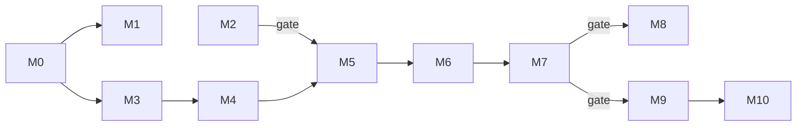

# Roadmap

kbui reaches its goal when a product's screens, whether a person, a coding agent or a model wrote them, are checked and fixed against one contract, and people prefer the result. The [product document](product.md) describes every feature; this document orders them into milestones.

Each milestone has a pass mark, set before the work starts. The same pass mark sits in `progress.json` as a `not-run` entry until the milestone is checked; then the entry records the date, the result, what was measured and the evidence at a fixed commit. The portfolio site builds kbui's project page from that file. Nothing is marked done on the strength of a report alone.

## Milestones

Status on 2026-10-22.

| | Milestone | Status |
|---|---|---|
| M0 | Foundation | Done |
| M1 | First product screen | In progress |
| M2 | Field test | Up next; needs no kbui code |
| M3 | Catalog breadth and layout | Not started |
| M4 | Contract and catalog | Not started |
| M5 | Rule engine | Not started |
| M6 | Render and measure | Not started |
| M7 | Preference comparison | Depends on M6 |
| M8 | One bar everywhere | Only if M7 passes |
| M9 | Edits and nested surfaces | Only if M7 passes |
| M10 | Promotion from use | Only once a product composes at runtime |

M1 and M2 run side by side. M1 tests whether kbui is used; M2 tests whether the problem kbui plans to solve exists in today's constrained runtimes. Both are cheap, and either can narrow the plan before any generative code is written.

## Gates

Two results can stop or narrow the plan. Their thresholds are fixed here so that the result decides, not the mood after it.

| Gate | Result | Decision |
|---|---|---|
| M2 | 20% of screens or more violate an integrity rule | Integrity and safety rules lead. Continue to M3. |
| M2 | Between 10% and 20% violate any integrity or design rule | Design rules lead. Continue to M3. |
| M2 | Under 10% violate any integrity or design rule | Catalog constraints already solve most of the problem. Keep M3 and M4, and stop the rule work (M5 onward). |
| M7 | Fewer than 37 wins in 60 blind pairs | Stop after M4. Keep the manifest and schema exports, and use existing runtimes as they are. |

### M0. Foundation

What: a design system other projects can install.

- `@kbui/tokens`, `@kbui/css` and `@kbui/react` with the anatomy contract, the palette ban, story and test coverage, the neutrality guard and the skin fixture guard.
- 13 components: `Button`, `Input`, `Dialog`, `Panel`, `Status`, `Badge`, `Stat`, `Progress`, `Callout`, `Tooltip`, `Menu`, `ScrollArea` and `Toolbar`.
- Storybook with an accessibility scan of every story.
- Lockstep tarball releases with an install check on Ubuntu, macOS and Windows.

Pass mark: every package builds, every component has an anatomy line, a story and a test, every story passes the accessibility scan, a release installs and passes the smoke run on three operating systems, and CI passes on `main`.

Result on 2026-10-22: pass at `d812777`. 31 token, 16 CSS, 72 React, 18 script and 9 pack tests, and 150 of 150 story tests. Releases 0.1.0 to 0.4.0 shipped.

### M1. First product screen

What: one real product screen built on kbui, so that components grow from real use rather than ahead of it.

- The first consumer is a desktop app whose task screen uses kbui 0.4.0 components only, with product-specific parts kept in the product's own repository.
- Every component that screen needed and kbui lacked was added to kbui, not copied into the product.

Pass mark: one real product screen built on kbui is merged in its own repository with its checks passing, by 2026-11-02.

Left to do: merge the screen's pull request in the consuming repository.

### M2. Field test

What: find out whether catalog-constrained runtimes still produce the problems kbui's rules target. It needs no kbui packages and takes about two days.

1. Write 30 prompts across commerce, settings and dashboards, including the neutral shop prompts from source S30 of the [evidence report](superpowers/specs/2026-10-22-generative-ui-evidence.md#sources).
2. Generate them with json-render and its shadcn catalog, using two models.
3. Write about ten integrity, design and arrangement rules by hand against json-render's spec format.
4. Render each screen at three widths with Playwright and run the accessibility scan and the geometry checks: overlap, overflow and target size.
5. Count the screens with at least one violation, by rule family.
6. Record time to first node, time to complete and token counts as the speed baseline.
7. Have one person label 50 screens and score the rules' precision and recall against the labels.

Pass mark: the share of screens with an integrity violation and with any violation is recorded, the speed baseline is recorded, and every rule has a precision score; the [gate](#gates) above then decides the next step. Rules below 0.7 precision are rewritten before M5.

### M3. Catalog breadth and layout

What: enough components and layout to compose real screens.

- About 20 more components, including `Heading`, `Text`, `Card`, `Table`, `Tabs`, `Select` and `EmptyState`, chosen from what product screens need.
- Layout primitives `Stack`, `Grid` and `Split`.
- Layout intents `ListDetail`, `SupportingPane`, `Feed`, `Dashboard`, `Form` and `Settings`, each with collapse rules per size class.
- Patterns `StatsRow` and `FormSection`.
- Screenshot assertions from [0008](decisions/0008-visual-regression-with-vitest-browser-screenshots.md) for every component.
- A LICENSE file inside each package tarball.

Pass mark: the catalog has at least 30 entries, each with an anatomy line, a story, a test and a screenshot; every layout intent collapses correctly at three widths in a story test; the accessibility scan is clean in light and dark; and `bun run check` and `bun run test:stories` pass.

### M4. Contract and catalog

What: one contract that generates the catalog agents read.

- An anatomy parser that reads parts and attribute values, one anatomy grammar for every component including `Dialog`, and one source for variant values.
- The `manifest` package: canonical tree types with `repeat`, conditional visibility, two-way binding and typed bindings; tree and manifest versions with migrations.
- The generated manifest, with a when-to-use description, props, slots and examples for each entry.
- Structure rules exported as JSON Schema, and a focused catalog for each surface.
- Storybook's MCP addon enabled as an interim catalog for coding agents. This can land at any time.

Pass mark: the manifest regenerates byte for byte from the same source, a deliberate mismatch between a component and its entry fails the drift test, and the exported schema accepts every catalog example and rejects a seeded invalid tree.

### M5. Rule engine

What: the `lint` package, with rules in five families and fixes for each.

- Integrity and safety, structure, design, arrangement and data fit, as listed in the [rule catalog](product.md#rules).
- Deterministic fix patches, lossless first. Diagnostics written as instructions a model can act on.
- The rules run on every story in CI.

Pass mark: a deliberately bad screen is flagged and fixed with no model call, every story passes the rules, each rule scores at least 0.7 precision on the labeled screens from M2, and seeded violations in passing trees are caught.

### M6. Render and measure

What: generated trees on screen, and numbers for every stage.

- `render-react`: streaming render, placeholders for unknown nodes, checks on each node as it arrives, and a stop on a fatal violation.
- The rendered-geometry stage at three widths, built on the screenshot infrastructure.
- One model repair round with the remaining diagnostics.
- `test:gen` with about 30 prompts: validity, lint pass rate, token adherence, token cost, time to first node, time to complete, repair time, and what each pipeline stage caught and cost.
- Selection prompts for every catalog component.
- The offline judge, kept apart from lint.

Pass mark: `test:gen` results are committed to the repository and reproduce with one command, every catalog component has selection prompts with a recorded pass rate, and every stage reports its catch rate and cost.

### M7. Preference comparison

What: find out whether kbui's rules and fixes produce screens people prefer.

60 prompt pairs, judged blind: kbui's catalog with rules, fixes and one repair round, against json-render with the shadcn catalog. Record the time each screen takes, including repair.

Pass mark: at least 37 wins in 60 pairs. A lower result triggers the [gate](#gates).

### M8. One bar everywhere

What: the same rules wherever UI comes from.

- The `mcp` package: catalog search, lint, code generation, and one call that returns lint, accessibility, geometry and fix patches for a screen.
- A parser that reads static kbui TSX back into the tree.
- Adapters `adapter-a2ui-0.9`, `adapter-json-render` and `adapter-mcp-apps`, each with golden fixtures, a capability declaration and a weekly canary against upstream schemas.

Pass mark: one screen written as a story, as agent TSX and as an A2UI and a json-render tree gets the same lint result in all four forms; each adapter's fixtures validate against the upstream schema and render; and the canary has run green for two consecutive weeks.

### M9. Edits and nested surfaces

What: change one part of a screen without regenerating it, and nest other agents' surfaces safely.

- Stable node ids and JSON Patch edits.
- Slot rules for foreign surfaces such as MCP App panels, with nesting limits.

Pass mark: at least 80% of the `test:gen` edit prompts apply as patches without regenerating the screen, and lint rejects a foreign surface placed in a slot that does not allow one or nested deeper than the slot allows.

### M10. Promotion from use

What: a saved composition becomes a named pattern, and then a real component.

Starts only once a product lets its end users compose screens at runtime.

Pass mark: a saved composition becomes a manifest pattern with typed inputs that the model reuses in `test:gen`, and promoting it generates a component, story and test that pass `bun run check` and `bun run test:stories`.

## Recording progress

When a milestone is checked, append an entry to `progress.json` with the same `subject`: the date, the result (`pass`, `partial` or `fail`), a one-line summary of what works and what is left, what was measured, and the evidence path at the commit that holds it. Entries are append-only and oldest first, so a milestone's history stays readable. Experiments (M2 and M7) use `kind: "experiment"`; the rest use `kind: "milestone"`. The portfolio site validates the file against its schema on every build.

When a milestone's scope changes, update this document and append a new `not-run` entry with the new pass mark in the same change, and say why in the commit message. Earlier entries are never edited.
